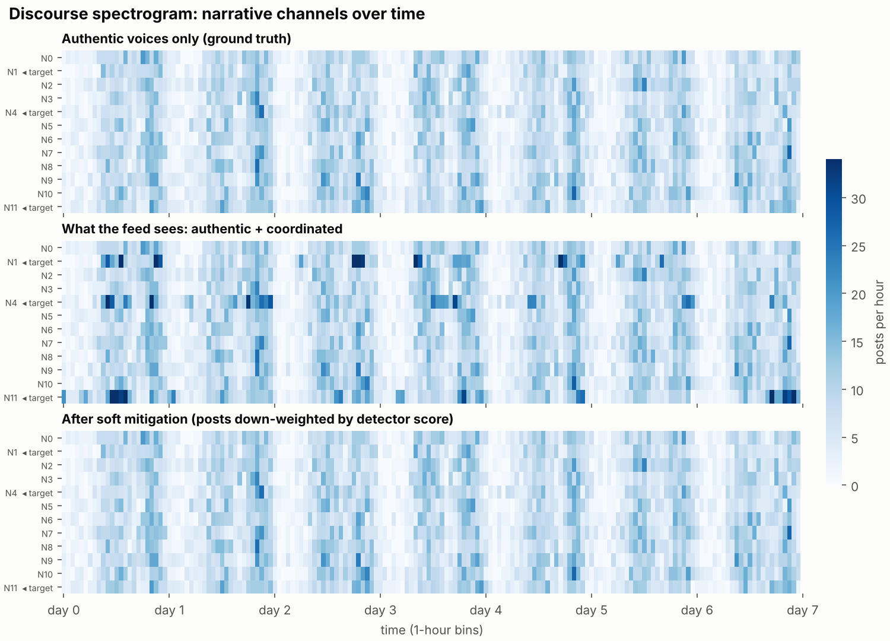
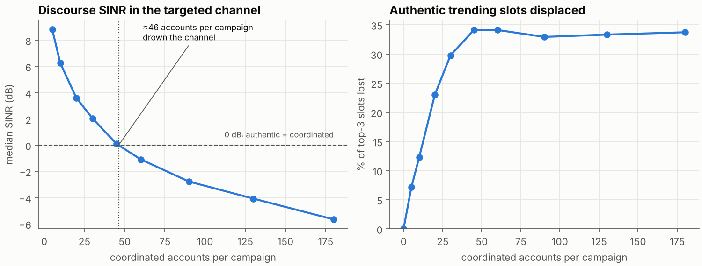
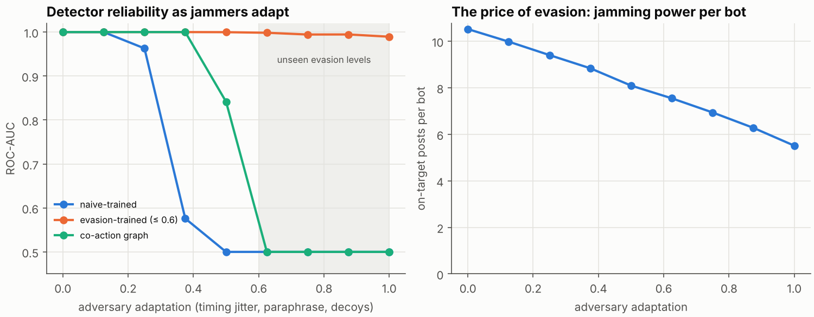
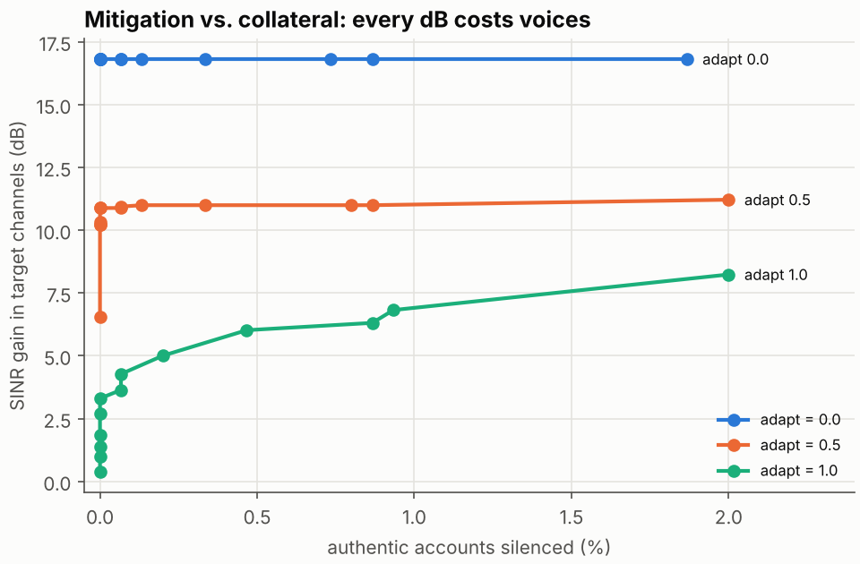
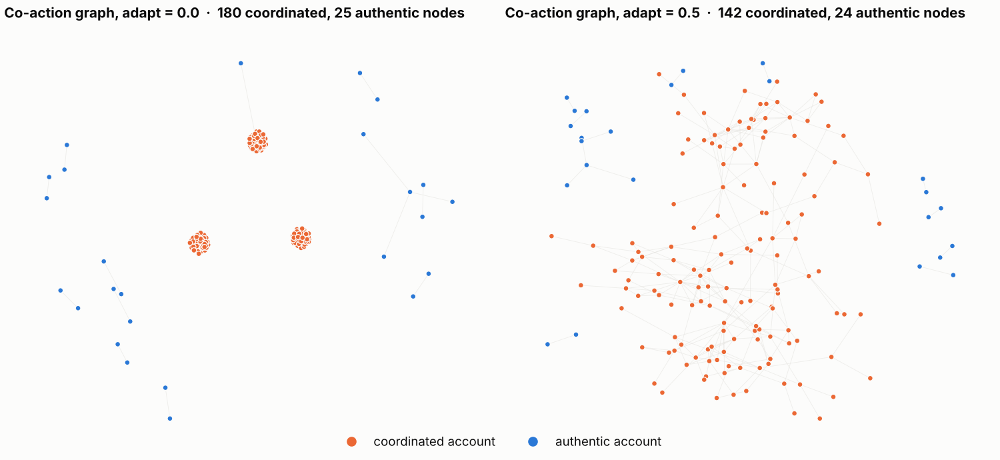

# Discourse-SINR

**Treating coordinated influence campaigns as jammers in the information space.**

In RF security, a jammer does not need to decrypt anything. It only needs to raise the
interference floor until the legitimate signal can no longer get through. A coordinated
campaign on social media works the same way. It does not have to convince anyone. It only
has to drown out authentic voices.

This project takes that analogy literally. It borrows three tools from RF jamming research
and applies them to a simulated social stream:

1. **A measurable quantity.** The *discourse SINR* is the ratio of authentic to coordinated
   volume in a narrative channel, measured in dB while the campaign is active.
2. **Detection under an adaptive adversary.** Jammers hop frequencies and lower their power
   to evade detection. Here, campaigns add timing jitter, paraphrase their messages and post
   human-looking decoys.
3. **Mitigation with a cost.** In RF you can notch out a jammer. In a democracy, every filter
   also risks silencing a real person. The project measures both sides of that trade-off.



*Narrative channels over time, drawn like an RF waterfall. Coordinated waves appear as
bright bursts in the three target channels (middle). Detector-weighted mitigation largely
restores the authentic picture (bottom).*

---

## Key results

All numbers come from `results/results.json` and are reproducible with one command (below).

| Question | Finding |
|---|---|
| How much coordination does it take to drown a channel? | About **46 accounts per campaign** (≈2.8% of active accounts) push the target channel below **0 dB SINR**. Just **10 accounts per campaign** already displace **12%** of authentic trending slots. |
| Do detectors survive an adapting adversary? | A detector trained only on naive campaigns falls from **AUC 1.00 to 0.58** at adaptation 0.375, and to chance level from 0.5 onward. The label-free co-action graph holds out longer, then also collapses (**0.84 at 0.5, chance from 0.625 onward**). |
| Can that be fixed? | Training with *some* evasion (adaptation ≤ 0.6) keeps **AUC ≥ 0.99** even at unseen levels up to 1.0. Recall at 1% false positives still decays (**0.99 → 0.84**). |
| Which signals survive evasion? | Content and co-action signals collapse (self-similarity AUC **1.00 → 0.30**, twin-post rate **1.00 → 0.53**). Rhythm signals barely move (hour-of-day entropy **0.93 → 0.93**, spectral peak-to-average ratio **0.87 → 0.86**). Coordination leaves a scheduling fingerprint. |
| What does evasion cost the attacker? | Fully adaptive bots land **48% fewer** on-target posts (10.5 → 5.5 per bot). In the test run used for mitigation, evasion lifts the target channel's SINR from **−1.1 dB to +4.8 dB**. Evading detection means jamming less. |
| What does mitigation cost real users? | Against adaptive campaigns, hard removal gains **+3.3 dB at zero collateral**, but reaching **+8.2 dB silences 2% of authentic accounts**. Soft down-weighting gains **+16.7 / +10.6 / +3.3 dB** (adaptation 0 / 0.5 / 1.0) while removing only **0.3%** of authentic weight. |






---

## How it works

**Simulation** (`src/simulate.py`). Posts are vectors in a 32-dimensional "narrative
space", standing in for sentence embeddings. Twelve narrative centres act as frequency
channels. Each simulated week contains:

- **1,500 authentic accounts** with heavy-tailed activity, daily rhythms, session-clumped
  posting and personal topic interests.
- **3 campaigns** of coordinated accounts. Each pushes a slanted message into one target
  channel in synchronised waves.
- **One adversary knob, `adapt` ∈ [0, 1].** It controls timing jitter (3 → 63 min),
  paraphrase noise, a shift of waves into daytime, and decoy posting. Total bot volume stays
  human-like, so the detector gets no free signal from volume.

**Features** (`src/detect.py`). Each feature family mirrors a jamming-detection idea:

| Feature | RF analogue |
|---|---|
| Inter-post CV, burstiness | pulse / duty-cycle statistics |
| Spectral peak-to-average ratio of hourly activity | spectral line detection |
| Normalised hour-of-day entropy | deviation from the band's normal occupancy |
| Self-similarity of own posts | narrowband, low-entropy emitter |
| Twin-post rate, co-action degree and strength | several transmitters locked to one carrier at one time |

**Detectors.** The project compares three:

- Gradient boosting trained on naive campaigns.
- The same model trained with partial evasion (adaptation ≤ 0.6).
- A label-free co-action graph: accounts posting near-identical content within 15 minutes
  are linked, and Louvain communities of five or more accounts are flagged.

**Metrics.**

- **Discourse SINR:** `10·log10(S / (I + N0))` per 6-hour window in the target channels,
  over attacked windows only, with N0 = 1 post as the noise floor. Reported as the median.
- **Displacement:** the share of authentic top-3 "trending" slots lost to coordinated volume.
- **Detection:** ROC-AUC and recall at 1% false-positive rate, averaged over 3 test seeds.

---

## Run it

```bash
pip install -r requirements.txt
python src/experiments.py      # ~30 s on a laptop CPU; writes figures/ and results/
```

No downloads and no API keys. Every run is seeded and deterministic.

---

## Limitations, and what comes next

- **This is synthetic data.** The finding that rhythm signals survive evasion depends on how
  I modelled human posting, which is session-clumped. That is exactly what has to be tested on
  real data.
- **The adversary is parameterised, not learned.** A natural extension is a learning attacker
  that maximises SINR damage under a detection budget. This is the game-theoretic setting
  studied for reactive jammers.
- **Displacement uses a simple volume-ranked feed.** Real ranking algorithms add engagement
  and personalisation, which could amplify or dampen the effect.
- **The social side is not yet modelled.** How users perceive down-weighting compared with
  removal is a question for user studies, not simulation.

**Next step:** validation on public coordinated-behaviour benchmarks such as TwiBot-22 and released state-backed information-operations datasets, and replace the latent vectors with real sentence embeddings.

---

